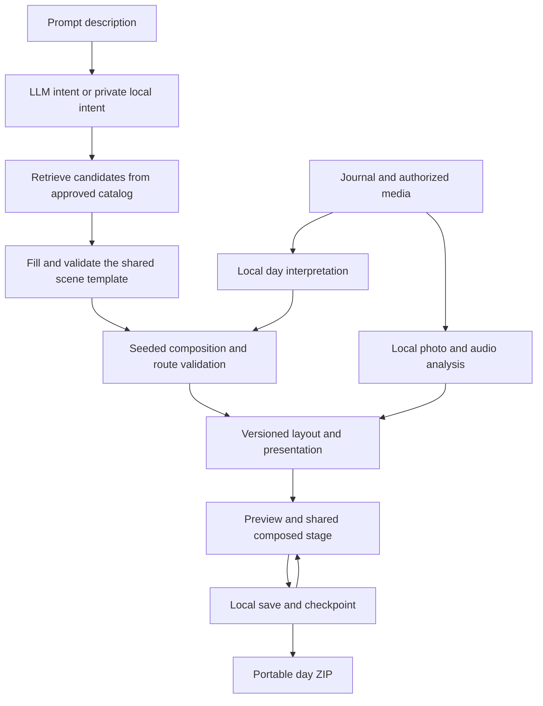

# Memory Worlds implementation plan

21 November 2026 · Implementation specification for the three-developer team · Baseline `798ea7f`

## Product and release scope

Memory Worlds is a browser game about revisiting a short memory on foot. The player describes a place in ordinary language. An LLM understands the request and plans a scene using a shared template and a prebuilt library of at least 100 distinct 3D models. The player walks the resulting low-poly place, discovers two meaningful objects, and reaches an ending tied to it. A park should look like a park on arrival, with trees, paths, seating, and a gazebo. A water park should have recognizable pools, slides, and a dry route between attractions.

| Entry | Player provides | Visit and result |
|---|---|---|
| **New Game → From a prompt** | A place name as short as `park`, or a full description with objects, relationships, time, weather, and people | Both **Build memory** and **Build world** use the shared LLM scene planner when it is enabled and the player has chosen that processing mode. Preview the built features, substitutions, and soundtrack. The memory adds a short imagined encounter and the world has a landmark ending. Both save locally. |
| **New Game → Create a day memory** | Date, original journal text, one to three authorized photos, and the day's associated song as an authorized file | Walk to a photo artifact and an exact journal excerpt, then reach the day's ending. The system generates a three-to-seven-word title. Save to the day archive and export a titled ZIP. The original photo and associated track remain attached to the day. |

The supplied *Prompt-to-World Implementation Plan* informs art direction and the scene contract. The latest user direction establishes LLM scene planning and a catalog of at least 100 distinct models as product requirements. In the supplied gameplay screenshot, a bare rectangular green surface, a marker, and a gate give the player no way to recognize the requested place. The release tests use `park` and `water park` as their first two cases. The organizer brief still governs the diary and submission. [Case brief](../reference/document_en.md) · [Requirement IDs](00_case_requirements.md) · [Working rules](../AGENTS.md).

| Scope decision | Implementation |
|---|---|
| Keep the engine and the approved art style | Extend the existing Vite, React, TypeScript, React Three Fiber, Three.js, and Zod application. Keep the current controllers, archive readers, and authorized local audio path. |
| Accept open-ended settings | Interpret any nonblank description within the input limit. Create worlds by combining reusable surfaces, structures, landscape, props, and atmosphere from multiple environment families. A closed catalog limits exact visual reproduction. For an unusual request, retain its distinctive features through compatible geometry or show an explicit substitution or missing feature. |
| Make the asset library a release gate | Target 120 eligible asset IDs and ship with at least 100 distinct, tested, licensed models. Begin with park and water-park sets, then cover indoor, urban, coastal, forest, fantasy, and science-fiction combinations. |
| Make two discoveries and one ending the release contract | Prompt stories get one character, a greeting, and two authored local replies. The diary ending uses the player's source material. Consider longer visits after the release gates pass. |
| Use the LLM to design the scene | Replace the current model-to-rewritten-description path with structured intent, catalog retrieval, and a validated scene template populated with known IDs. Deterministic engine code resolves the exact geometry, routes, and collisions. Keep the diary and an explicitly labeled private/offline mode local. |
| Keep the scope on world building | Use authored and rights-cleared low-poly models, bundled with the app and loaded on demand. Defer swimming, ride physics, free-form character dialogue, cloud saves, and asset generation to separate decisions. |

**Delivery priority.** The first product slice must deliver a convincing park and water park from their names alone. The full prompt-world release requires the LLM path, 100 eligible assets, and successful coverage beyond both parks. The case deadline is **22 November 2026 at 23:59 Astana time**. Package a verified diary build against that deadline and track the larger prompt-world release on its own gates. [Case submission brief](../reference/document_en.md) · [Earlier delivery plan](game_development_plan.md#active-delivery-plan--2026-11-21).

## Repository baseline and implementation seams

| Area | Existing implementation | Work in this plan |
|---|---|---|
| Navigation and intake | `App.tsx`, `menus/`, `NewPromptGame.tsx`, `CreateMemoryForm.tsx` | Keep routes and the two entries. Tighten the preview, playback handoff, active-session navigation, and jury examples. |
| Prompt generation | `parse-prompt.ts`, `compose-world.ts`, `recipes.ts`, `layout-schema.ts`, `world-schema.ts`, `route.ts` | Split intent and catalog resolution from placement. Accept short prompts, introduce a validated template and composed layout format, and retain v1/v2 readers. |
| LLM gateway | `server/gemini-story.ts`, `compose-memory-story.ts`, `memory-story-schema.ts`, `NewPromptGame.tsx` | Reuse the development provider boundary with a scene-planning schema. Both prompt actions use it. The story becomes an optional layer on the resolved scene. A production adapter needs an approved deployment and data path. |
| Short story | `compose-memory-story.ts`, `memory-story-schema.ts`, `StoryCharacter.tsx`, `GameSession.tsx` | Ground local writing in the actual discoveries and place. Finish camera, focus, captions, and save restoration. |
| Gameplay and rendering | `gameplay/controller.ts`, `gameplay/layout.ts`, `WorldStage.tsx`, `WorldScenery.tsx`, `world-recipes.ts`, legacy `WalkStage.tsx` | Add route dressing and camera clearance to the composed renderer. Keep the v1 adapter and its regression cases. |
| Diary and audio | `generate-memory.ts`, `validate-day-draft.ts`, `MemoryViewer.tsx`, `photo-analysis.ts`, `audio-analysis.ts`, `world-soundtrack.ts`, `music-motion.ts` | Make each input visibly affect the result, frame the original image on a nearby object, and carry the associated song through replay. |
| Persistence and delivery | `game-repository.ts`, `indexed-memory-repository.ts`, `checkpoint.ts`, `day-zip.ts`, existing Vitest and Playwright suites | Preserve database and ZIP readers. Add fixtures for the new presentation profile and missing, stale, or interrupted states. Verify the production build and release package. |

There are 19 recipe IDs in `src/world/recipes.ts`. The current parser treats `park` as a grass surface, recognizes `water` as a separate feature, and lacks a distinct water-park interpretation. The 10-character minimum also rejects the bare `park` and `water park` prompts. If a longer prompt identifies a surface but few usable objects, the composer can fill its interaction slots with generic markers. The optional model integration writes a new scene description and passes it back through this same parser. These facts explain how the game can produce a technically completable scene with very little of the requested place. The 75 passing unit and 40 passing browser tests in the prior progress log cover core behavior. Recognizable prompt results, the asset minimum, and physical-device acceptance need new evidence. [Parser](../src/world/parse-prompt.ts) · [Prompt bounds and layout schema](../src/world/layout-schema.ts) · [Recipes](../src/world/recipes.ts) · [Composer](../src/world/compose-world.ts) · [Story adapter](../src/world/compose-memory-story.ts) · [Recorded baseline](../PROGRESS.md#2026-11-21--short-prompt-memory-experience).

## Screens and player journey

| Screen | Required behavior |
|---|---|
| **Title menu `/`** | New Game, Continue, Load Game, Examples, and Settings. Continue opens the latest committed checkpoint. A stale or unreadable checkpoint leads to an explanation and a route to the saved world or spawn. With no checkpoint, disable Continue and quietly explain when it becomes available. |
| **New Game `/new` and prompt `/new/prompt`** | Keep **Build memory** and **Build world**. Accept 1–600 user-perceived characters within a bounded encoded payload, require a nonblank description, and preserve exact input. Offer `park` and `water park` as fillable examples. Show planning and building status, the chosen processing mode, key rendered features and substitutions, the soundtrack, and a specific edit hint where needed. Revisions keep the textarea and discard superseded results and audio. Ignore late responses after edit or exit. |
| **Day creation `/create`** | Validate locally, flag each invalid field, and focus the first error. Retain the entry, date, and all usable selections after failure. The shipped case route uses an authorized file. State the accepted formats and limits at the file control. |
| **Active visit** | Show title, day date where applicable, `0 of 2` discovery progress, a short next objective, an audio control, and Pause. Show keyboard hints on desktop and touch controls on touch. Material for the current reveal and final response must be readable at a 390 CSS px viewport. Put interpretation and credits in a secondary panel. Route every in-app exit from an unsaved visit through the existing confirmation flow. Back navigation and reload must leave the last committed save usable. |
| **Pause** | Resume, Save Game, Save & Quit, and Return to Main Menu. Clear movement on open and pause sound. Trap focus in the menu, restore it on close, and prevent double saves. Announce success after commit. Keep the visit and the current dialog usable after storage failure. |
| **Load Game `/load` and Archive `/archive`** | Load Game lists prompt worlds and journal days, with date, progress, and save status. Archive is the diary feed, with photo thumbnail or intentional fallback, date, generated title, and palette accents. An imported day opens at spawn. Archived media and layout reopen using the saved data. Keep existing `/play/:id` and `/memory/:id` routes. |
| **Examples `/examples` and World preview `/world-preview`** | Present five consented or fictional diary examples as a coherent contact sheet. Add stable deep links for case examples if time allows. Keep cove and market developer previews available directly. Use the prompt entry to demonstrate generated worlds. |
| **Settings `/settings`** | Keep volume and the system/forced reduced-motion preference. Apply settings without restarting a visit. Reduced motion suppresses camera smoothing, vignette/fade motion, bobbing, beat pulses, and ambient particles while preserving lighting, captions, progress, and audio controls. |

## Generation and saved scene contracts

### Prompt interpretation, catalog retrieval, and planning

1. **Read the user's intent.** Give the provider a bounded prompt and the allowed environment, surface, role, relationship, and atmosphere vocabularies. Return strict `WorldIntent` JSON with one to three setting concepts, up to 24 requested or implied features, up to 20 relations, sizes/counts/colors, and explicit exclusions. Separate requested features, inferred defaults, and imaginative embellishment. Preserve source phrases for explicit requests. Match those phrases back to the original string and resolve uncertain or repeated mentions conservatively. Treat the prompt as data, with no provider tools, file access, or URL fetching. Block blanks and control-only text, allow terms such as `park`, and exercise Russian and English cases, emoji, negation, and multiword places.
2. **Find candidates in the actual catalog.** Query a checked-in asset index for each object and scene role. Rank exact aliases and compatible tags before category substitutes, then check allowed support, scale, and use. Keep up to four candidates per key role and a compact combined shortlist capped at 48 distinct IDs. Retain exact requested matches even if optional detail has to be dropped from the shortlist. Use the whole index for lookup. The model sees shortlist metadata with stable IDs and captions, while the renderer pulls geometry from the shipped library. Return a missing feature when no compatible candidate exists. A high semantic score cannot override an asset's support and movement restrictions.
3. **Fill the common template.** Make a second structured-output call with the intent, compatible models, zone and connection vocabulary, and family requirements. The model selects known IDs and assigns them to zones, landmarks, memories, paths, and atmosphere. It supplies no numeric coordinates, code, shaders, or download links. The template is a scene specification. A park, a café, and a mixed science-fiction forest use the same schema and placement engine. Each generated scene gets its own zone arrangement, asset selections, route, and seed. Gemini's structured outputs can constrain JSON shape. Validate references, semantic coverage, and the resulting route in project code. [Gemini structured output documentation](https://aistudio.google.com/docs/structured-output).
4. **Validate and handle gaps.** Validate both model responses in the gateway and validate the final template in the client against the exact catalog version and candidate IDs. Require each requested defining feature to be present, explicitly substituted, or visibly missing. Distinguish missing decoration from a missing landmark that would make the label misleading. Allow at most one targeted corrective model call within a 20-second total model budget. Send specific errors and the original intent, never broaden the request because a feature is hard. If validation fails or the provider is unavailable, preserve the prompt and offer **Try again** or **Build privately**. The private mode uses the same engine and family requirements with deterministic intent and asset selection. A local result that passes the setting's checks is a playable fallback and is labeled **Built privately**. Otherwise show the unresolved feature and suggest a supported variant as an explicit choice.
5. **Preserve diary privacy and source handling.** Keep the 6,000-character intake and private analysis. Continue using the existing source-grounded journal title and photo/song flow. When a day can use the common renderer, supply its intent locally. Keep the older day adapter with the original media for days without a usable composed layout. For all flows, display excerpts from the stored original string. The model can propose an imagined reflection for the prompt story, while direct quotation comes from the original input. Use the entire journal for title, context, and excerpt as today. Selecting geography across the whole journal can follow the release.

### Scene template contract

Proposed module boundaries are `world-intent-schema.ts`, `catalog.ts`, `scene-template-schema.ts`, and `compose-scene-template.ts` in `src/world/`. B owns the versioned TypeScript/Zod shapes and gateway adapters, C owns the catalog and its validation inputs, and A owns navigation and route assertions.

| Field group | Template limits and invariants |
|---|---|
| Identity and intent | `version`, `catalogVersion`, input-derived title, ordered settings, time, weather, mood, and local soundtrack cues. Save an engine-selected unsigned seed. Preserve exclusions and reference validated spans of explicit source details. |
| Zones | Up to eight zones with unique IDs, surface and environment family, relative size class, and desired role. Compose grass, paving, indoor floors, sand, rock, decks, and shallow water display areas. Give blended settings a zone boundary and a readable transition. |
| Connections | Up to 12 typed connections such as path, entrance, door, boardwalk, bridge, or airlock. Both endpoints must exist. The spawn and every required interaction belong to a single walkable component. A label such as airlock can use a compatible door assembly. |
| Asset groups | Up to 32 semantic groups. Each specifies a catalog ID, zone ID, purpose, bounded count, expected support, and optional allowed color or scale variant. Separate explicit props, required environment features, and optional dressing. A source request to exclude a feature takes precedence over its family default. |
| Relationships | Reference zone or asset group IDs, using `beside`, `beyond`, `above`, `under`, `in front of`, or `inside`. Check every claimed relation against final transforms and support. An approximate relation is visible as such. |
| Play and presentation | One spawn, two distinct contextual discovery anchors, an ending landmark, preset-controlled sky, light, fog, and dressing. Story mode adds the existing optional character and dialogue, with no second generation pass for geometry. |
| Coverage | List explicit requests and defining features with `placed`, `substituted`, or `missing`, plus a bounded reason where needed. Verify this against the realized plan. A success state requires usable silhouettes, a contextual route, and no invisible required objects. |

For `water park`, the template should include an entry/deck zone, a pool zone, and a slide attraction with a connected deck-side approach. A pool basin, entry arch, tube slide, splash pad, and shade structure come from the catalog. Connect dry walk zones and mark free water as unsupported for walking. The player spawns at the arch, reaches discoveries at the pool edge and a shade or viewing deck, then ends at an overlook. The profile can change the layout dimensions and shift where the attractions sit. An explicit request such as “two slides and no splash pad” changes the asset groups and suppresses the implied splash pad. The result shows a simplified slide as a substitution only if a variant compatible with the request is available.

### Composition and reachability

1. Seed layout from the original input, template and catalog/layout versions. Persist the accepted template and actual seed for reproducible replay. Give route, decorative scattering, and color variance independent seed streams. The same accepted template, seed, and version tuple reproduce the scene. A fresh provider call may produce a different valid template from the same prompt.
2. Place the zone graph and its shared transitions. Reserve spawn, two approaches, the ending, and a continuous supported route. Place landmark/support pairs first, then explicit requested objects and their relations. Fill semantic context and layer optional clutter last. Keep P0 interactive maps compact. Treat the current 80 placements and 120 stored solids as starting composition caps, and batch decorative instances separately. Flag an over-budget explicit request as approximated. Use deterministic retries to widen or move flexible approaches before thinning optional elements.
3. Reserve a clear path about 1.4 units wide on open ground, plus wider turnaround space at interactions. Derive hard limits from the existing radius of 0.3 units and reach of 1.7 units. Use the same recipe dimensions and rotations for visuals, supports, and solids. A shoreline cannot be walked without dry land or a supported deck. A room exit shares its doorway width between rendering, collision, and path checks. Decor near those spaces is low and nonblocking.
4. Reuse the collision-backed reachable grid, currently 0.2-unit cells. Join connected cells using segments the controller can traverse. Validate that each discovery can be activated first, then activate the remaining one and the ending with the two possible reveal orders. This also catches interactions masked by another target, blocked doorway corners, and attempts to interact through a wall or across an unsupported gap. Mark a route used for a visual guide only after this check.
5. Use at most four placement attempts. Drop optional dressing before disturbing a defining feature. A generic marker and gate cannot satisfy the landmark and discovery requirements of a known setting. Report any requested item or relation changed. If route or coverage still fails, show a specific reason and an edit or private-mode action. Leave the draft intact. A day that falls back to its existing deterministic renderer still keeps authentic artifacts and audio.

### Versioning and interfaces

Introduce `PromptWorld` v3 with `SceneTemplate` v1, catalog v3, layout v3, and an optional bounded story. Add a processing provenance enum for provider and private modes without storing raw provider replies. Keep explicit v1/v2 layout and v2 prompt record readers, `MemoryScene` and day manifest v1, and checkpoint v1 unless the serialized state changes. Include the new layout and asset versions in the checkpoint identity. For a composed day `world.json`, add a versioned layout wrapper only when the new renderer's serializer is ready. The legacy day fallback still works without `world.json`. Unknown versions produce a readable error before store writes. An older application may require an update to read new composed day layouts.

| Contract | Contents and owner |
|---|---|
| **Resolved world** | B keeps original source, stable UUID, accepted scene template, seed and version tuple, interpreted terms and their evidence, zones, final placements, two discovery anchors, ending, and optional bounded story. Record the canonical layout before entering play. |
| **Recipe metadata** | C maintains stable IDs, labels, aliases, palette slots, render parts, footprint, approach, surface support, count cap, allowed zones, and whether the recipe can serve as a landmark or discovery. B and C review the parser alias and example together. |
| **Walk layout** | A consumes `toWalkLayout` with spawn, bounds, supports, collision footprints, interaction points, and range. A adds camera blockers and interaction sight checks from trusted geometry. The gameplay controller sees data and stable IDs. |
| **Presentation profile** | C owns the draft profile resolver, with B defining replay inputs. Given the saved layout, seed, version, current day photo/music features or chosen prompt track, resolve a context profile, route dressing, palette/light values, fog, and motion parameters. Keep the computation pure and fixed per version. Render quality can reduce density or effects without changing gameplay, source evidence, or landmarks. |
| **Stored story and progress** | B keeps story v1 with local source, original prompt, resolved place, bounded mood, one character, two discovery notes, greeting, two distinct reply labels and answers, and closing text. A owns runtime progress and validates the reachable position, unique reveal IDs, and conversation/ending state on restore. |

Use strict parsing before new storage writes and after import. Cross-check terms, model IDs, placements, zone claims, discovery eligibility, story and source, and media IDs. Preserve v2 saves from the fictional Gemini story path. Store the exact accepted asset IDs and their catalog version. Keep a compatibility mapping only where a renamed asset is demonstrably equivalent. Previously authored or imported layouts reopen from saved data without an LLM request, new scene selection, or asset reselection.

## Prebuilt asset library

The prompt-world release requires **100 distinct, selectable, render-tested 3D models**. Aim for 120 eligible IDs so the team can reject weak models without falling below the floor. An original procedural recipe counts if it produces a distinct authored silhouette and use, with its own model ID. Recolors, scale changes, format conversions, LOD meshes, instances, and aliases count once under their base asset. Count each eligible model in exactly one family. Every entry must be placeable in at least one tested setting. Shared models can appear in multiple settings.

| Family | Inventory target | Examples and priorities |
|---|---:|---|
| Vegetation and landscape detail | 18 | Broadleaf tree, pine, willow, birch, palm, shrub, hedge, fern, flower bed, boulders and reeds. Prioritize the park canopy and water-edge silhouettes. |
| Park and civic grounds | 14 | Gazebo, pergola, park gate, seat, picnic table, drinking fountain, ornamental fountain, planter, trail sign, lamp and fence modules. |
| Water park and recreation | 16 | Open flume, tube slide, launch tower, pool basin, splash arch, water jet, lazy-river bend, lifeguard chair, cabana and shade canopy. Author the missing signature pieces as modular originals. |
| Surface and passage geometry | 12 | Decks, short bridge, boardwalk, ramp, stair structure, door, arch, rock ledge and tunnel portal. Only label assets walkable after shared support checks pass. |
| Urban exteriors and structures | 18 | Shopfront, kiosk, stall, market canopy, house, station facade, street furniture, towers and skyline shapes. |
| Interiors and furniture | 16 | Counter, cupboards, stove, table, chairs, bookcase, window, bed, floor lamp, shelves and distinct small objects for discoveries. |
| Rural and coastal places | 10 | Lighthouse, pier, rowboat, buoy, barn, windmill, cabin, and retaining pieces with shore or field support. |
| Fantasy, science fiction, and character silhouettes | 16 | Stone ruin, floating slab, crystal, airlock frame, dome, panel, porthole, rover, and recognizable character bodies for scene scale. |
| **Inventory target** | **120** | **Release floor of 100 eligible models.** |

C starts with the existing builders, original signature meshes, and candidate packs with clear license provenance. Kenney's Nature Kit, City Kit Commercial, and City Kit Roads are sources for foliage, background structures, and street pieces. Audit the specific source archive and choose only models that fit the project's visual system. Keep the creator, source, version, license, modifications, and proof in the asset ledger. [Nature Kit](https://kenney.nl/assets/nature-kit?part=e79b84f8-9663-4137-a688-08360a0b0f3d) · [City Kit Commercial](https://kenney.nl/assets/city-kit-commercial) · [City Kit Roads](https://kenney.nl/assets/city-kit-roads) · [Kenney license guidance](https://kenney.nl/support).

1. **Normalize once at build time.** Put imported meshes in the project's local asset tree. Normalize units, forward direction and ground pivot. Replace clashing materials with shared matte palette slots, preserve identifying silhouettes, and export a tested GLB or register an original typed builder. Generate a small contact-sheet thumbnail for review. Keep the renderer's mesh and collider transforms in the same reference frame.
2. **Register the model.** Catalog metadata includes stable `assetId`, revision, load key, display label and aliases, tags and semantic roles, valid environment and support types, bounds, footprint, approach socket, scale range, palette slots, instancing eligibility, polycount, and license reference. Terrain-facing pieces specify where they attach. Elevated or water-edge features specify dry approaches and which surfaces, if any, are walkable. Keep bundled asset URLs in the trusted load map and expose only compact metadata to the LLM.
3. **Run the catalog gate.** Add a planned build check that rejects duplicate IDs or geometry-family duplicates, missing geometry or credits, invalid transforms, absent semantic tags, and broken substitutions or support sockets. Produce a per-family count and contact sheet. Load each entry in an isolated gallery, check origin, scale, and material, then exercise collision or support for each interactive asset class. Count only entries that pass. Report actual inventory and pack byte size.
4. **Load selectively.** Include the index with the app. Load model chunks needed by the accepted plan from the app's own static assets. Use cached assets when offline. Share repeated meshes and materials, instance decorations, and dispose per-visit resources. A model that fails to load stays listed as missing or uses an approved substitute with the same function. Required models must load and appear before showing a successful preview.

## World art and atmosphere

Use the same avatar proportions, flat-shaded materials, restrained outline-free silhouettes, typography, title treatment, and discovery marker across scenes. Vary depth, rhythm, source color, and light direction. Each space has a low foreground, middle-distance silhouettes, an identifiable anchor, and a horizon or framed exterior. A readable path is part of the scenery. Soft dawn atmosphere and a hard-lit night market should be recognizable in grayscale as well as in color.

| Place | Route and landmark | Scene construction and dressing | Contrast and sound |
|---|---|---|---|
| **Park** | Entrance path → bench or flower-bed discovery → gazebo approach and ending | Connect path branches and frame them with at least five trees across at least two silhouettes. Add a recognizable gazebo, at least two seats, flower beds or planters, a lawn edge, and a tree-lined middle distance. From spawn, show the path and either the gazebo or an obvious intermediate cue. | Light key beneath the canopy, restrained greenery, and warm focal accents. A quiet track and light foliage motion give the route a rhythm. |
| **Water park** | Entry arch → dry deck around a pool → slide viewing approach, then a shaded overlook | Include a pool basin visibly edged by safe deck, at least two recognizable water attractions such as a flume and splash feature, a lifeguard chair or cabana, and far-side planting or buildings. Add water reflections or color bands, slide supports and their visible outlets, and deck details. Keep walk and collision support continuous around pools. | Sunlit water, contrasting slide colors, and a bright track. Audio and subtle water animation distinguish the attractions from the cove. |
| **Foggy cove** | Dry headland approach → boat or lantern discovery → signed pier approach → view of the lighthouse and ending | Polygonal dune and rock silhouettes, shoreline color band, rock arrangements, beach grass, driftwood or buoys from the catalog, and a distant headland. Keep the deck visibly connected and the boat where the named relation places it. | Cool haze with warm light accents and clear pier edges. Quiet synthesized coastal track and, if the optional mix ships, one gentle shore bed. |
| **Covered night market** | Lit entrance → stall or crate discovery → bridge underside → ending in a lit court | Modular stalls, canopy rhythm, crates, paving-edge detail, roof silhouettes, and warm points of orientation. Canopies clip or recede near the follow camera. The bridge must read as a passage from both approaches. | Dark skyline and warmer route lights, with denser silhouettes and a brighter automatic track. Keep the HUD legible against lit stalls. |
| **Kitchen and garden** | Room anchor and first discovery → readable doorway → garden discovery and ending in sight | Window framing and table or shelf clutter give the room identity. Pavers transition to planting and flower clusters. Use a distant silhouette through the window, with a visible floor and wall edge. Keep furniture out of the exit approach. | Soft interior pool and cooler exterior haze. Let the visual transition mark progress. Prefer quieter tracks where tags match. |
| **Park, room, and city day examples** | Two authentic artifacts and the previously supported ending | Dress only where the composed profile exists. Legacy layouts remain covered by established tests. Use paths, windows, and facade layers to support the diaries' different moods. | Original photos supply accent color and measured lightness. The associated song drives actual playback motion. |

Resolve a presentation profile from both intent and placed features. Distinguish managed recreation water from natural shore so `water park` cannot fall into the cove profile. Allow each zone in a mixed scene to have its own scenery treatment and route cues. Add seven visible layers where they fit the setting. Establish its floor or terrain, landmark silhouette, context props, midground scatter, foreground edges, horizon or framed exterior, and optional motion. Review four views at spawn, mid-route, last discovery, and ending. Exterior targets are **60–160 decorative instances**, **at least four recognizable decorative types**, three height bands, one coherent distance layer, and two secondary points of interest. Interiors target **12–30 small details** across two depth layers plus a window or doorway view. A clearing can be quiet while still giving the player a readable next cue. Flag any five-second stretch with neither a visual cue nor an authored pause. Reduce counts on lower quality. Enforce the setting's defining landmarks and contextual route at generation time. Review decorative quotas on rendered scenes and hardware.

Draw the path over validated waypoints. Round corners only where a sampled segment still has controller clearance. Use paving seams or a low terrain-edge stripe to guide movement, and different edge treatment for sand, grass, and room transitions. For P0, use edge meshes and distant relief to suggest terrain while the walk surface remains predictable. Base water and its shoreline edge on the same bounds as deck support. Prefer an unlit gradient sky, mesh silhouettes, and regular fog over full-screen effects.

Instance repeated grass, small rocks, crates, and flowers by shared geometry/material. Seed scale between roughly 0.8 and 1.25, rotation from the recipe's allowed angles, and modest color variance in the same palette slot. Use bounded cell sampling with a path mask and exclusions around approach, door, deck, and camera corridors. Batch distant silhouettes. Use one ambient/hemisphere key and one directional key, a tight shadow region where performance permits, and capped local light or emissive materials for guidance. Limit the effect layer to one visible particle family per scene. Store recipes and style maps as versioned build code. Start with original geometry and existing rights-cleared content. Any imported asset needs units, origin, material, footprint, visual review, and a license record before it can enter the catalog.

### Input-driven visual rules

| Evidence | Visible result | Explanation panel shows |
|---|---|---|
| Recognized place, named objects, and verified relations | Ground type, landmark silhouette, placement, and approach. An edited rowboat color changes its material. Changing a valid relation changes its placement. | Source words, object or zone chosen, and any approximation. |
| Time, weather, and mood cues | Time sets key-light angle and sky. Fog determines visible depth. A quieter context spaces secondary props into clusters, with a calm middle distance. Tension uses narrower pools of light and stronger angular accents. Joy uses more distinct lit clusters and a quicker ambient rhythm. | A short rule and the evidence that triggered it. Mark inferred mood as an artistic interpretation. |
| Original photo | Use the first photo's dominant color for lighting accents and a secondary color for nearby detail. Reuse `0.65 + 0.65 × meanLightness` as the ambient multiplier. Tint decorative material toward the secondary swatch with a 20% starting blend in linear color space. Preserve an explicit user-requested object color. | The actual swatches and their roles. A frame and a reveal card link back to the original asset. |
| Associated audio or selected prompt soundtrack | Preserve the existing 100 ms measured energy envelope and mean energy. Use `0.25 + 0.75 × meanEnergy` as the motion rate and the current 0.04 pulse gain against interpolated energy at the playback position. Pause, silence, and reduced motion settle the animation. | Track title, measured energy, and the channels it affects. BPM and key remain unknown unless a measured implementation is later validated. |

Show the first day photo in a nearby in-world frame when a composed profile is active. Use a derived preview texture within 1,024 px on its longest side, fit the image without cropping, and keep byte-exact original media in the card and archive. Attach the frame to the already reserved photo discovery approach, so it adds no collision. When more photos are supplied, show them as a small gallery on that reveal and include all originals in the ZIP. Missing or undecodable display media leaves the exact journal excerpt and ending usable. Explain what the engine actually applied. The techniques sheet can name atmospheric perspective, chiaroscuro, and photographic framing when those treatments appear in the reviewed scenes.

## Movement, discoveries, and the ending

| State | Player action and transition |
|---|---|
| **Arrival** | Start at validated spawn looking toward the first useful route cue. Show a brief objective and a visible landmark or guiding light. A first-time player should find a route cue without opening a help panel. The static view starts with the same objective and saved reveal state. |
| **Exploring** | WASD and arrows or a touch pad move the avatar. E or **Interact** acts on the nearest actionable target in range with a clear line of interaction. Keep the existing 3.2 units/sec, bounded time step, normalized diagonal input, collision and wall sliding. Prioritize an unrevealed target when two actionable zones overlap. Release held input on pause, blur, visibility change, touch cancellation, and exit. |
| **Discovery** | Highlight the target within reach and present a labeled, readable card after activation. Record the stable discovery ID once. Show the day photo or exact journal excerpt, or exact prompt text plus the story's clearly imagined observation. The user can close or review that card. Both reveal orders work. A repeat action cannot change the counter or unlock the ending early. |
| **Landmark ready** | After two distinct discoveries, change both its visible marker and the objective text. The plain and diary modes end on a nearby interaction. Prompt stories open a modal conversation at the character by that landmark. Keep the character out of the walk lane and show its text name so identification works in grayscale. |
| **Conversation** | Freeze locomotion, frame the character, and focus the greeting. Offer two short keyboard/touch replies. Commit one choice, show its stored answer and closing line once, and move focus to the completed section. Escape opens the pause menu, then resumes the same conversation and focus. Saving during the conversation must restore the open dialog. |
| **Complete** | Resolve light or ambience locally and show a short closing beat. The diary can use the photo or exact excerpt as the closing source. Keep Replay and the session exit available. Replay resets the visit and preserves the chosen soundtrack. The stored checkpoint changes only on explicit save. Reset position moves to spawn while keeping discoveries. |

In `WorldStage.tsx`, test camera clearance from a target above the avatar to the desired follow-camera position. Use cached solid bounds plus simple height data from C's geometry. Move in immediately before a hit and ease outward when clear. Treat broad leaf planes and canopy dressing as optional fade or cutaway geometry. Reserve space behind spawn and at door, deck, and conversation approaches. Keep the avatar, target marker, and next route cue visible at those points in the camera review. If the position we restore is outside safe bounds or a support was lost, offer spawn recovery. Use controller-backed line and support samples in interaction and route tests. Keep the six anchor approaches across the cove, market, and mixed setting in the regression set, alongside all three endings.

Capture one guided onboarding check and at least one cold playtest on keyboard and one on physical touch. Aim for a 90-second to three-minute first story visit including reading. Record actual times and where players needed help. The longer story roadmap can target three to five minutes if scene size and more narrative beats justify it.

### Local story writing

Improve `compose-memory-story.ts` using the actual selected discovery recipe and nearby exact source phrase. The opening mentions the place and a clear next action. Discovery delivery has two parts, an exact source excerpt and an imagined reflection. A recognizably named person may become the locally portrayed character in prompt mode. Where no name is clear, use a setting-appropriate role such as **Pier keeper** or **Market vendor**. Phrase generated dialogue as fiction and avoid assigning a real person private beliefs, quotes, or new events. Write 6–8 small grammar or line variants across three setting profiles, with two distinct choices that change the response and share the same reachable ending. Keep the story bounded and stored before play. No free-text reply, remote call, or speech synthesis is needed during a visit.

## Soundtrack and sound design

| Channel | P0 implementation |
|---|---|
| **Prompt soundtrack** | Reuse the three bundled original compositions with mood, setting, and energy tags. They are authored note patterns rendered locally to playable WAV. Show match reasons and keep the current stable tie-break. Allow preview, track change, mute, and authorized upload. If no cleared match or playable file is available, name silence and offer a replacement. Save selected media, attribution, measured features, and mute state. |
| **Diary soundtrack** | Use the exact authorized associated file chosen by the player. Preserve its measured features and original bytes through save, reopen, and ZIP import. When it ends, allow replay. Missing audio has a clear unavailable state and the rest of the visit works. |
| **Playback and synchronization** | Start sound from an explicit player gesture. Transfer the chosen track from preview to the visit without two players sounding at once. Pause all audio in Pause and on leaving the visit. Resume prior position in the same visit when the browser allows it. A restored visit asks for a gesture and may restart the saved track. Ended, muted, and blocked playback reset any live visual pulse. Revoke replaced object URLs and disconnect any nodes on exit. |
| **Optional mix before the release candidate** | If the core device and presentation checks are already green, add one quiet setting bed and one discovery cue using the existing audio stack. Keep the associated song foregrounded. Mute and pause cover every channel. Post-release positional sound can add up to two local emitters after phone testing verifies the stereo fallback and cleanup. |

Capture a controlled two-track comparison with identical journal, photo, seed, and camera. Show audible playback and record the difference in mean energy, derived motion setting, and visible response. Repeat at rest, pause, and reduced motion. Optional ambience and the prompt catalog provide separate evidence from the case song. Keep all selected assets and consent data local. The song-link workflow is scheduled after release with a deliberate user-supplied metadata description and explicit link opening. Use the existing file route for all five submitted days.

## Persistence, failure handling, and privacy

| Event | Expected result |
|---|---|
| First prompt save | In one IndexedDB transaction write the realized world and story, selected track record and Blob, mute choice, and checkpoint under the stable ID. Day progress writes the validated day, its media, and namespaced day checkpoint atomically when a save is needed. |
| Later save or multi-tab use | Freeze a single save snapshot and serialize the UI's save actions. Check the stored checkpoint revision against the one this visit opened or most recently committed inside the same transaction. On concurrent replacement, offer to reopen the latest save or explicitly keep this visit's progress. Roll back every partial write. Save & Quit leaves only after success. |
| Restore and replay | Validate world and layout identity, media associations, checkpoint bounds and collision, discoverable unique IDs, and consistency of reply and ending. The latest committed save drives Continue. If its checkpoint is stale or unreadable but the world is usable, offer **Restart from spawn**. A damaged world or unknown version shows an error and keeps the record. Replay and restart leave the committed record intact until the next save. |
| Day ZIP | Keep a title-safe folder with `manifest.json`, `entry.txt`, `credits.json`, optional `world.json` and `preview.png`, `photos/`, and `audio/`. Export original authorized assets and the realized layout when present. Check paths, members, sizes, CRC, decoded media, manifests and IDs before writing. Retain identical reimport behavior and refuse conflicting reuse of an ID. Portable case archives start at spawn. Prompt snapshots and live checkpoints stay browser-local for P0. |
| Media and storage failures | Keep the intake draft, generated visit, or current save as appropriate. Report field-level decoding errors, quota or blocked storage, and missing assets in the relevant screen. Offer retry and, for a valid day, local ZIP export. WebGL failure switches to a labeled static sequence with both reveals, story or day ending, and accessible audio. Reset position and Replay remain available from the relevant visit state. |

Retain current media caps for launch. Photos are JPEG, PNG, or WebP up to 5 MiB each and 16 megapixels. Audio is authorized WAV or MP3, 1–90 seconds, up to 10 MiB. Study rights for each asset's intended playback, ZIP reuse, deployment, and video. Record authorship, consent, restrictions, and attribution for photos, music, fonts, geometry, and any narration. Use permitted or fictional material in public examples. Include dependencies, versions, and AI tools actually used in the release ledger.

### LLM deployment boundary

The first LLM slice uses the existing loopback Gemini gateway with explicitly fictional prompts. Reuse the provider adapter and add scene-planning endpoints with server-held keys, strict input/output schemas, a single generation deadline, and server-side cancellation. A hosted planner is a product release requirement unless an approved local LLM meets the same end-to-end quality and device gates. Review provider terms and region/audience eligibility, approval for the data being sent, retention, and a quota and spend cap before enabling hosted access. Gemini is the staging integration. Select a production provider after that review. [Current loopback architecture](../ARCHITECTURE.md#short-prompt-memory-experience) · [Gemini API terms](https://aistudio.google.com/docs/terms) · [Gemini billing and caps](https://aistudio.google.com/docs/billing).

If approved, expose a bounded same-origin planning endpoint with request limits, a global call budget, token ceilings, and an operator kill switch. Start with one in-flight generation per session, three per minute, and a provider-call cap of three per generation. Confirm those limits under production traffic and error cases. Label processing before sending text and require the player's choice. Only the prompt-world planning action can send the short text and the catalog context it needs. Keep journal text, derived personal features, photos, audio, saves, and private-mode prompts on the device. Keep raw prompts and provider replies out of gateway logs, include no third-party tracking on these screens, and test the network boundary in the built client. Saved worlds and archived days reopen without a provider call. The case web build and private mode use local processing.

## Verification and release targets

Run the repository's `npm run typecheck`, `npm test`, `npm run build`, and `npm run test:browser` at each integrated gate. In Windows PowerShell, `npm.cmd` is equivalent, and `PLAYWRIGHT_CHANNEL=msedge` selects installed Edge when configured in the shell. The browser suite expects loopback port 4173 by default. Verify the built `dist/` separately on static hosting with a fresh profile, direct URL navigation, a hard refresh, and the network inspection described above. Save screenshots, logs, and device details with the test results. [Package scripts](../package.json) · [Browser test configuration](../playwright.config.ts) · [Existing acceptance tests](game_development_plan.md#acceptance-and-regression-checks).

Map intake, input-built scenes, and song influence to MIN-01/02/03 and USR-04. Map titles, portable folders, and archive to MIN-04/05 and USR-02/10. The art and example set cover MIN-06 and USR-07. Rights and submission evidence cover MIN-07/08 and USR-06. The walking loop, prompt composition, and soundtrack selection cover USR-01/08/09. The shared LLM scene planner and catalog coverage add USR-11/12. Handoffs and the documentation log cover USR-03/05. [Requirement definitions](00_case_requirements.md).

| Check | Method and passing evidence |
|---|---|
| **AT-01–03, AT-05, AT-23** | Assert invalid shapes and source spans fail. Compose the same accepted template with the same seed and versions twice. Compare layout, presentation profile, and stable object IDs without generated visit IDs. Test the cove, market, and mixed kitchen/garden. Change one count, color, or relation and check realized geometry and reported coverage. Change just the source photo and verify applied color/light and the original photo card. Verify safe, meaningful 3–7-word titles and distinct IDs for duplicate titles. |
| **AT-10, AT-17–20 and story restoration** | Walk park, water park, cove, market, and mixed kitchen/garden, plus park/room/city diary regressions. Exercise both reveal orders, repetition, crossing a narrow doorway or pier, prompt reach, line-of-interaction blocking, camera clearance, reset, visibility loss, and reduced motion. Save before and during the prompt conversation and after each possible reply. Complete the plain prompt and diary flows. Exercise WebGL startup and context-loss fallback. |
| **AT-04, AT-09, AT-24** | Measure matching and playback as specified in Soundtrack and sound design. Verify preview switching, override and missing-file handling, per-world mute, audible device playback, no suspended audio after leaving, and consecutive open/close cleanup. Confirm the visual explanations use the same values as the renderer. |
| **AT-06/07/11, AT-20, AT-25** | Open v1 day storage and ZIP, old prompt world and checkpoint records, and a new export in a clean profile. Compare original bytes and load the same scene. Simulate quota, corrupt media, stale and foreign state, simultaneous saves, conflicting ZIP IDs, and denied playback. Assert no partial save, draft loss, secret leak, or generation call on reopen. |
| **AT-08/09/15/19/21** | Capture spawn, mid-route, last discovery, and ending at desktop and 390 px mobile widths for both parks and at least three other prompt settings. Take one five-card diary contact sheet. Review depth, landmarks, path legibility, contrast, camera blocking, clustering around anchors, and source accuracy. On a physical phone and a laptop, log browser/OS, viewport, DPR, renderer stats, and frame times over a 60-second moving visit in the park, water park, and one mixed setting. Exercise touch cancellation and audible playback on hardware. |
| **AT-12–14, AT-22/26** | Verify the rights and tools ledger, working fresh-browser route, role and milestone evidence, each of the seven deliverables, and the submission receipt. Mark failed or unavailable checks open in `PROGRESS.md`. |
| **AT-27 · Model-led composition** | Both prompt buttons exercise the same scene planner with provider mocks and a live approved planner run. Assert invalid IDs, invalid references, code, URLs, unsupported geometry, and excluded props cannot enter the renderer. Simulate timeout, blocked requests, invalid JSON, lost connectivity, and quota exhaustion. Verify explicit fallback and zero provider traffic for the private entry, diary, and save reopen. |
| **AT-28 · Catalog release floor** | The audited count of distinct licensed and render-tested model IDs is at least 100. Gallery tests load every counted model. Every catalog family contributes usable entries. Confirm that variants are deduplicated and required interaction/support rules are present for applicable assets. |
| **AT-29 · Recognizable worlds** | Both bare park prompts pass their scene-specific shape, asset, route, and screenshot checks in standard prompt mode and private mode. Test fresh combinations and substitutions. A scene that lacks the signature features of its named setting cannot succeed as that setting. Record object lists, coverage mismatches, and four-view captures. |

Target a 95th-percentile frame duration at or below 33.3 ms during the 60-second route on both phone and laptop. Aim for a 16.7 ms median on the laptop. Report both measurements and mark stalls over 250 ms. Start with targets of 150 draw calls, 150,000 visible triangles on mobile and 250,000 desktop, DPR at most 1.5, and preview textures at most 1,024 px. Measure planning separately from asset load and placement. Target a usable preview within 12 seconds on a warm online run. The model deadline is 20 seconds, after which the UI offers local mode or retry. Aim for three to five seconds for local composition, and two seconds from Enter World to responsive movement with preloaded scene assets. Measure separate cold and warm runs. Trim optional shadows, particles, and distance scatter before reducing foreground identity. Keep diagnostics free of personal input.

### Benchmark prompts and expected results

Use these invented prompts for repeatable captures and comparisons. Use the normal seed path end to end and pin template and seed in isolated comparisons. Add the two shortest cases in W1 and keep the wider matrix for W3.

| Prompt | Required evidence |
|---|---|
| `park` | Accepted exactly as typed. Five or more trees with two silhouettes, a gazebo, seats, flowers or planters, an obvious path, and a layered skyline. Route reaches two recognizable props and the gazebo or its approach. A flat lawn with markers fails. |
| `water park` and `waterpark` | Both aliases select managed recreation water. Pool, dry deck, two identifiable water attractions such as slide plus splash feature, shade or lifeguard context, and framing beyond the pools. Both discoveries and ending reachable without entering water. A beach, pier, or blue plane alone fails. |
| `A water park at night with two slides and no splash pad` | Same family with night lighting and at least two distinct slide placements. Exclude the splash feature and use a second slide as the attraction coverage. Show why if an explicitly requested count cannot fit. |
| `A greenhouse inside a lunar station, with a fern garden beyond the airlock` | Distinct enclosed technical zone and planted destination, joined by a recognizable passage. In a closed catalog, a suitable dome/window assembly or compatible door can be a labeled substitute. An outdoor park alone fails. |
| “At dusk I met Mira by a lighthouse above a foggy cove. A red rowboat was beside a pier. Two lanterns stood on the shore.” | Fog and dusk coexist. The lighthouse reads above the shoreline, the supported pier is reachable, and a red boat sits alongside it. Show two lanterns when both fit. A story visit ends with Mira after two discoveries, while plain mode ends at the landmark. |
| “At night I met Sam at a market under a railway bridge. Two stalls stood beside the bridge with a yellow lantern and a crate.” | Night skyline, readable bridge crossing, two stall positions, and a yellow lantern. Any unsafe or unclear placement is labeled. The atmosphere and automatic track differ from the cove. |
| “A quiet kitchen opened onto a garden at dawn. A table stood in the kitchen. A bench and flowers waited in the garden.” | One supported door connects regions. Table and bench remain on their intended sides. Flowers belong outside. Reach both discoveries and the ending from the same spawn. |
| Add “a levitating observatory” to the cove, then try a prompt with unsupported setting only. | The first keeps the reachable cove, labels the missing feature, and preserves the literal text. The second offers an edit and creates no save or unrelated world. |
| Use one supported place with a negated prop, then compare a valid `beside` edit against `beyond`. | A negated object does not become an asserted fixture. The relation edit changes relative placement with the same seed, or reports why one relation cannot be fulfilled. |

Build a 32-prompt suite with 10 short places, eight described places, eight hybrids, and six failure or stress cases. Include park, water park, neighborhood, coast, cavern, woodland, café, market, historical street, and science-fiction interior. Use recorded templates for deterministic automation. Run the two bare park prompts and eight additional unseen fictional prompts through the live approved planner at release. Two reviewers should independently recognize each park from its spawn or mid-route image with labels hidden. Require at least seven of eight unseen results to be judged recognizable and faithful to their main features by both reviewers. All successful results must be walkable, explain approximations, and pass structural setting checks. Keep evidence for any failed result and add it to the regression corpus. Label unsupported features as gaps even if the engine can render the rest of the scene.

## Work packages and delivery gates

A owns gameplay, navigation, camera, checkpoints, and device acceptance. B owns intent and scene contracts, provider and catalog retrieval, menus, saved readers, and release. C owns catalog production and rights, art, atmosphere, audio, examples, and capture. B supplies `WorldIntent` and `SceneTemplate` fixtures before wiring the model. C supplies stable IDs, scaled meshes, support, footprints, and reference views. A provides route and camera budgets and reviews the prototype against the same template.

### Case deadline track

Freeze a candidate from the verified diary branch. A runs the two-reveal loop, touch and replay on that exact build. B verifies original media persistence, old imports, archive reopening, privacy, and packaging. C checks hardware, prepares five example days with cleared sources, and records the favorite-day video. Allow approximately 15–20 focused person-hours across the three roles. Protect 16:00–20:00 Astana time on 22 November for the exact candidate's final checks and upload. The organizer deadline leaves contingency until 23:59. If static hosting is unavailable, use the brief's build or tested-instructions option. Report actual capability in the submitted prototype and keep unfinished prompt-world gates open. [Case submission options](../reference/document_en.md).

### Prompt-world product track

| Gate | A · Gameplay and device | B · Generation and release | C · Library and art | Focused hours A / B / C |
|---|---|---|---|---|
| **W1 · Park and water-park vertical slice** | Capture baseline and implement dry pool/deck and park routes, contextual approaches and camera clearance. Run both reveal orders. | Accept both bare prompts, wire `WorldIntent` and `SceneTemplate` to the loopback planner, and add the private family resolver and validated preview. | Finish the two distinctive landmark sets. Deliver 25–35 eligible models or builders with the first audited gallery and matching spawn/route captures. | 5–7 / 8–10 / 10–14 |
| **W2 · Catalog and composable settings** | Add supported multi-zone transitions and geometry checks for door, bridge, indoor/outdoor, and landmark approaches. | Build catalog index, ID allowlisting, template validation and repair, layout v3 save/read, and attribution in preview. | Reach at least 60 eligible models and pass layered visual checks across park, recreation water, urban, coast, woodland, interior, and one hybrid. | 7–9 / 11–14 / 18–24 |
| **W3 · Full breadth and candidate** | Exercise 3D play, mobile, reduced motion, both prompt actions, and restored story and diary saves. | Complete the 32-prompt fixture suite, provider approval and integration if authorized, fallback and privacy tests, and archive/ZIP regression. | Reach ≥100 eligible models against the 120 target. Complete the library contact sheet, review live/held-out prompts and device budgets, and polish profiles that fail visual review. | 8–10 / 10–13 / 15–19 |
| **W4 · Product release verification** | Reproduce movement and accessibility checks on the exact release candidate. | Run production smoke tests, verify approved planner and restored saves, record diagnostics, and stage rollout with a kill switch. | Check actual asset and track licenses, review final captures, and sign off the two parks and held-out scenes. | 5–7 / 7–10 / 6–9 |
| **Total by owner** | **25–33 hours** | **36–47 hours** | **49–66 hours** | **110–146 person-hours** |

Estimates assume three people work in parallel, eligible third-party packs cover much of the generic catalog, and C creates the signature water-park and gazebo geometry. At six focused hours per developer per workday, C's catalog and visual review alone require roughly nine to eleven workdays. Re-estimate after W1 measures the normalization rate and after the provider decision. Keep provider approval and asset production parallel with engine work. At each gate record exact commands, capture locations, catalog counts, device observations, and unresolved checks in `PROGRESS.md`.

Cut optional sound beds, extra particles, expensive shadows, expanded story branches, multi-tab conflict handling, and unrelated examples before cutting composition work. Protect the 100-model floor, the two park gold cases, semantic breadth tests, and walking and persistence requirements. A deferred provider decision leaves the model-led product gate open. Continue to test the same template interface with approved fictional loopback prompts and provider fixtures.

| Main risk | Owner and response |
|---|---|
| Catalog is large on paper and thin in useful coverage | C reports eligible models per family, duplicate families, and missing roles. B tests actual retrieval hits. Reject a variant-heavy count and address missing signature pieces before adding more background meshes. |
| LLM suggests an invalid asset, ignores negation, or times out | B validates against the candidate IDs and source intent, applies the bounded repair, and offers explicitly labeled retry or private build. A verifies the resulting route. |
| Photo or music lacks permission for public video, ZIP, or web use | C checks intended uses before preparing examples. Select an authorized owned or CC0 asset where appropriate. B requires rights evidence before including it in public files. |
| Camera correction accidentally changes the walk or hides the next target | A keeps independent camera and movement bounds and exercises all approaches on mobile and desktop. C lowers or moves near-camera decor as the first fix. |
| Phone runs slowly or audio is inaudible | C measures on hardware and trims optional effects. A verifies controls and visible/audio gesture state. B reports the exact tested scope if a physical gate stays open. |
| Storage rollout or hosting breaks saved play | B exercises both v1 inbound formats and the exact production build, including nested routes. Fall back to the last verified candidate or the brief's permitted local build/instructions submission. |

The case build and local tools retain the approved **$0 new service spend** target. Use eligible assets from the existing library, original geometry, cleared packs, IndexedDB, ZIP, and OBS. B verifies static hosting and the actual submission path. The hosted prompt planner has a separate operating budget decision. Measure calls and token usage on the staging corpus and present cost per successful world, estimated monthly volume, and a hard spend cap before deployment. The plan assumes no new paid service has been approved. [Project cost decision](../AGENTS.md#billing-amendment--2026-11-21).

## Case examples and submission

Prepare five actual diary results. Reserve slot one for a consenting team member's favorite day. Proposed remaining slots are a tense indoor deadline, a peaceful city evening, a joyful park reunion, and a reflective rainy kitchen/garden visit. They can use fiction with cleared media and a visible label. Generate all titles from their entries. Use the same title, date, frame, and palette treatment in the five-card feed. Confirm at least three distinct moods in individual scenes. Ask the favorite-day contributor whether the rendered details convey that day and record their actual observations. Label any verified prompt-world demonstrations separately in the jury materials.

| Material | Release evidence and owner |
|---|---|
| **SUB-01 · Prototype** | B supplies the tested static URL or the brief's build/instructions alternative. A walks the jury route from a fresh profile. Confirm the landing page, public examples, direct URL refresh, original media and archive use. |
| **SUB-02 · Video** | C records the actual release candidate. B verifies a duration of at most 180 seconds, intelligible recorded audio, and the favorite-day input-to-archive sequence. |
| **SUB-03 · Results** | C delivers five day results, actual generated titles, and a readable contact sheet. B confirms the files and permitted media resolve on a clean profile. |
| **SUB-04 · Description** | B writes and renders at most one page on purpose, audience, fixed visual system, and the separate contribution of text, photo, and song. Include the actual tested limitations. |
| **SUB-05 · Techniques** | C supplies the rules that actually appear in the reviewed worlds, with the mood or source cue and a representative capture. |
| **SUB-06 · Technical evidence** | B supplies accessible source or an authorized archive and identifies A/B/C's original contributions. |
| **SUB-07 · Tools and resources** | B and C verify library versions, licenses and rights, asset sources, APIs and AI tools actually used, and applicable consent and attribution. |

| Video time | What to show |
|---|---|
| **00:00–00:35** | Enter the favorite-day text, select approved photo and song, generate, and show the actual generated title and input interpretation. Label edits that compress waiting. |
| **00:35–01:25** | Start the real track. Walk to the photo and exact excerpt, reveal both, and reach the ending. Save the day and show its titled folder. |
| **01:25–02:05** | Show two contrasting days and explain one applied visual rule for each. Show the controlled soundtrack change with the same source inputs. |
| **02:05–02:35** | Show the five-day archive feed, reopen the favorite day, and confirm its original photo and associated music. |
| **02:35–03:00** | If time permits, show two contrasting text-only worlds or a saved encounter at the landmark. Finish with prototype/source access and credits. |

B records artifact paths or URLs, the checker, run time, results, open gates, and the receipt in `docs/submission.md` during packaging. Keep preview URLs and unstaged private material out of the submitted package. [Case requirements and scoring](00_case_requirements.md#evaluation--section-10).

## After the prompt-world release

Schedule these increments after W4 and device review. Estimates are planning ranges for A+B+C combined. Keep import and resume regression tests running.

| Increment | Work and acceptance | Estimated effort |
|---|---|---|
| **1 · Broader composition** | B reads meaningful spans across the full day entry locally. C fills underrepresented semantic roles and scenery gaps found in the W4 review. A extends connection checks for spatial layouts the original compact maps could not represent. Each added family gets a short prompt, a mixed prompt, and an audited test case. | 18–24 person-hours |
| **2 · Longer prompt memories** | When playtests show a reason to stay longer, B and A design a versioned list of three required discoveries and one optional discovery with ordered or independent objectives. Keep existing two-object stories and checkpoints readable with their original IDs. C adds more place-specific writing and one additional role model where it improves variety. Verify all reply paths, save between any two beats, and record first-visit duration and completion on keyboard and touch. | 22–30 person-hours |
| **3 · Audio and media breadth** | C prototypes a deterministic variation of local compositions from a bounded mood/energy profile and spot-tests two positional emitters. B adds an associated-song link option only when it can open the original legal source and visibly use user-provided descriptive metadata. Store the original link and the analysis provenance as distinct fields. Preserve file/ZIP behavior and include missing, blocked, and offline cases. | 16–22 person-hours |
| **4 · Setting-specific movement when justified** | Add playable slopes only with matching surface support. Consider cab interiors, swimming, ride systems, and changes to gravity after measuring demand for those actions. Space, vehicle, and underwater themes can already use supported walkable surfaces and modeled surroundings in scene planning. | Estimate after profiling and measuring demand |
